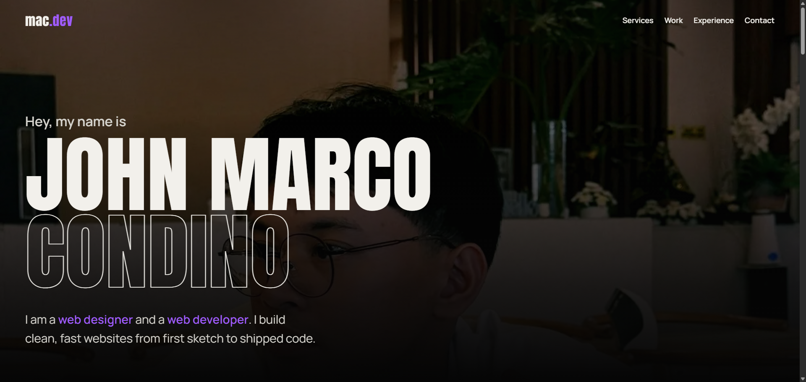

<div align="center">

<a href="https://johnmcndn.vercel.app">
  
</a>

<br />
<br />

# mac<span style="color:#a05cff">.dev</span>

### Hey, my name is John Marco Condino.<br />I design it. I build it. I ship it.

A black-and-purple portfolio with big type, smooth scrolling and a few tricks up its sleeve.

<br />

[](https://johnmcndn.vercel.app)


</div>

---

## ✦ What's inside

One page, a handful of sections, and a lot of care about how it feels to scroll.

| Section | What it does |
| --- | --- |
| **Hero** | A dark portrait, a huge name and a one-line intro. |
| **Skills strip** | A wall of logos in a big, bold type line. |
| **About** | The short version of who I am. |
| **Services** | Design, Develop, Deliver, as rows with a purple hover. |
| **Behind the work** | Four steps from first idea to launch, shown as sliding rows. |
| **Projects** | Cards that stack on top of each other as you scroll. |
| **Experience** | My jobs, plus education and certificates as illustrated cards. |
| **Contact** | A real contact form that lands in my inbox. |

## ✦ Little details I'm proud of

- **Smooth scrolling** with GSAP `ScrollSmoother`, plus `ScrollTrigger` for the pinned and sliding sections.
- **A contact form that works.** It uses a Next.js Server Action and [Resend](https://resend.com), with a hidden honeypot field to catch spam bots.
- **Built for every screen,** from small phones to 4K monitors. Text keeps scaling up on big displays instead of staying tiny.
- **Respects "reduce motion".** If a visitor turned animations off on their device, the site stays calm.
- **A custom 404 page** that fits the rest of the site.
- **One-click résumé download** in the Experience section.
- **All the words live in one file.** To change text, skills, projects or links, edit `src/data/content.ts` and nothing else.

## ✦ Tech stack

| | |
| --- | --- |
| **Framework** | [Next.js](https://nextjs.org) (App Router) and [React](https://react.dev) |
| **Language** | [TypeScript](https://www.typescriptlang.org), end to end |
| **Styling** | [SCSS](https://sass-lang.com), split into one partial per section |
| **Animation** | [GSAP](https://gsap.com) with `@gsap/react`, `ScrollTrigger` and `ScrollSmoother` |
| **Icons** | [react-icons](https://react-icons.github.io/react-icons/) |
| **Email** | [Resend](https://resend.com) |
| **Hosting** | [Vercel](https://vercel.com) |

## ✦ Run it on your computer

You need [Node.js](https://nodejs.org) installed.

```bash
# 1. Clone the repo
git clone https://github.com/johnmcndn/portfolio.git
cd portfolio

# 2. Install the packages
npm install

# 3. Add your environment variables (see below)

# 4. Start the dev server
npm run dev
```

Then open [http://localhost:3000](http://localhost:3000).

### Environment variables

Create a file called `.env.local` in the project root:

```bash
RESEND_API_KEY=re_your_key_here
```

| Variable | What it's for |
| --- | --- |
| `RESEND_API_KEY` | Lets the contact form send email. Get a key from the [Resend dashboard](https://resend.com). |

> Without this key the site still runs, but the contact form can't send messages.

### Scripts

| Command | What it does |
| --- | --- |
| `npm run dev` | Starts the site in development mode. |
| `npm run build` | Makes the production build. |
| `npm run start` | Runs the production build. |
| `npm run typecheck` | Checks the TypeScript without building. |

## ✦ Where things live

```text
src/
├── app/
│   ├── actions/sendMessage.ts   Server Action that emails the contact form
│   ├── layout.tsx               Fonts, metadata and the smooth-scroll wrapper
│   ├── not-found.tsx            The custom 404 page
│   └── page.tsx                 The page: every section in order
├── components/                  One component per section
├── data/content.ts              All the text, skills, projects and links
├── styles/                      SCSS partials, one per section
└── types/content.ts             Shared TypeScript types
public/
├── images/                      Portrait and README preview
└── John Marco Condino Resume.pdf
```

## ✦ Make it yours

1. **Change the content:** edit `src/data/content.ts` (name, email, skills, projects, experience).
2. **Change the colors:** the purple and the black are variables in `src/styles/_variables.scss` and `_base.scss`.
3. **Replace the résumé:** drop a new PDF with the same name into `public/`.

## ✦ Deploying

The site is deployed on Vercel. To deploy your own copy:

1. Push the repo to GitHub and import it on [vercel.com](https://vercel.com).
2. Add `RESEND_API_KEY` under **Settings → Environment Variables**.
3. **Redeploy.** Vercel only applies new variables to new deployments.

## ✦ Let's talk

Have a project in mind? Tell me a little about it and I'll get back to you with the next steps.

- 🌐 **Portfolio:** [johnmcndn.vercel.app](https://johnmcndn.vercel.app)
- 💼 **LinkedIn:** [linkedin.com/in/johncondino](https://linkedin.com/in/johncondino)
- 🐙 **GitHub:** [@johnmcndn](https://github.com/johnmcndn)
- ✉️ **Email:** [johnm.cndn@gmail.com](mailto:johnm.cndn@gmail.com)

---

<div align="center">

Designed and built by **John Marco Condino**, with a lot of coffee and one too many `ease` curves.

© 2026 · Take inspiration, but please don't copy it as it is.

</div>
